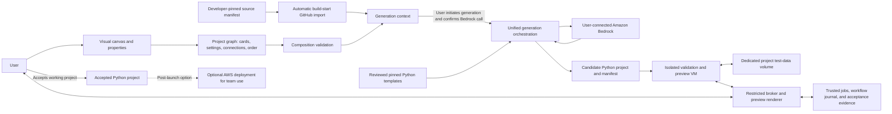

# Visual Programming Project Framework

**Final Draft v1.0 — 2026-11-08.** Accountable owner: the Visual Programming Project developer. This is the crew's implementation baseline, not a claim that the product, safeguards, or evaluation have been completed. “Must” and “required” are release requirements; numerical defaults remain versioned requirements until changed through the decision process below.

Preserve the launch boundary unless the accountable owner approves a recorded framework revision with scope, compatibility, migration, and acceptance impacts. Implementation choices listed in §8.2 must be resolved by their stated gate; they do not authorize changing product policy. Each work package produces reviewable artifacts and evidence before dependent work proceeds. One person may hold several crew roles, but implementation, review, and verification remain separate responsibilities.

## 1. Product Vision and Audiences

Build actual software through a visual, card-based workspace. Users assemble an application from existing cards, configure them, connect them, and arrange their order. After composition is complete, the system generates the application as one unified step. The launch language for generated projects and card-template code is Python.

The two primary launch audiences are **non-developer operations builders** and **learners**. The following role descriptions and pains are hypotheses, not validated research findings or universal claims:

- **Non-developer operations builder:** Responsible for inventory and operations records, needs to create, update, validate, filter, and report on them, but does not write application code. The hypothesis is that open-ended vibeCoding may spend excess tokens on recurring needs and produce code that is hard for a non-coder to inspect. Cards may reduce build time and token use while making generated structure more inspectable.
- **Learner:** A self-directed Python learner who understands basic syntax and functions and is building an early multi-module inventory/operations application. Formal student status is not required; beginners learning syntax from scratch are not the initial context. Cards may make project organization easier to explore and projects easier to construct, but learning value remains a hypothesis.

The product tests whether cards reduce build time and token use and exposes software structure for inspection; comprehension is not a KPI. Completion, time, and token metrics do not establish learning outcomes or validate architectural learning support. Launch users build with the existing card library, configuration, and connections. Custom cards and direct code authoring may be considered after launch.

Launch is a local, single-owner build and preview experience with persistent test data. An individual build task finishes when a Python project's preview starts, passes its predefined functional checklist, and is accepted by the user. Platform launch readiness additionally requires the isolation, persistence, catalog, and evaluation gates in §8. AWS deployment for team use is optional after launch and requires a separate production design.

## 2. Product Goals

- Let users construct working software through existing cards, their configuration, and their connections.
- Make each card's purpose, configuration, inputs, outputs, and relevant behavior inspectable.
- Keep drag interactions local to in-memory canvas state: no task-triggered network requests, model calls, subprocesses, dependency work, source refresh, or persistence in drag handlers. Ordinary UI/OS rendering remains allowed. Explicit **Save** persists the graph; **Generate** saves and pins a revision before initiating its confirmed Amazon Bedrock calls.
- Use each user's Amazon Bedrock connection for launch AI generation.
- Target a launch catalog of **200 cards** using the accepted planning allocation: 30 UI/interface cards (15%), 60 backend-processing, 30 data modeling/storage, 25 logic/validation, 15 triggers/orchestration, 20 integrations/connectors, 10 AI capabilities, and 10 navigation/output. Count each card once in one primary category and allow secondary tags.
- Generate launch project and card-template code in Python. Other languages may be considered later, but are outside launch scope.
- Define launch task completion as a successful preview that passes the accepted functional checklist and is accepted by the user.
- Compare build time and token use against a vibeCoding baseline. Target less than 75% of baseline, with less than 50% as ideal; selected card-heavy programs should target less than 20% of baseline.
- Do not impose a per-generation response-time SLA. Track task completion time separately from generation wait time.

## 3. Build and Generation Workflow

1. Start a build and create an owner-scoped project. Import the developer-defined, pinned GitHub snapshot before generation; the developer alone controls sources, inclusion rules, and refreshes. End users do not select or approve sources. This automatic build-start import is separate from Generate's Bedrock confirmation.
2. Retain source URL/revision, reviewed license, attribution, and provenance. Exclude missing or ambiguous licenses. Import failures follow the verified-cache/blocking policy in §6.6. Dragging obeys the in-memory interaction boundary in §2.
3. Configure cards, connect them, and set their order. Bind the graph to immutable specification/template versions and establish the project's functional acceptance checklist.
4. Validate contracts, dependencies, data schema, preview permissions, and the model profile; explain the exchange policy before Generate. Actual exchange decisions occur inside the generation job and are not runtime states.
5. The user initiates unified generation and confirms its bounded Bedrock calls. Assemble reviewed templates and generate project-specific Python using the graph, card contents/order, and imported context. Runtime records and credentials are not automatically supplied as AI context. Internal validation, tests, and bounded repairs are defined in §6.4.
6. Inspect and run the candidate only after isolation checks pass, using disposable validation data separate from the promotion copy. Exercise the checklist, persistence, and simulated manual-action flows. Imported GitHub material is generation context, not runtime records.
7. Accept the exact passing candidate and the clean promotion-data plan in §6.5. Promote its code, manifest, and clean data together under the project lock, retaining the previous matched snapshot. This completes the individual build task, not all platform launch gates.
8. Revise cards/configuration and generate a new candidate when needed. Preserve accepted code/data and out-of-band modifications; follow migration, promotion, and rollback rules in §6.5.

Generation duration depends on the composition and card order. There is no fixed response-time limit for an individual generation. The product should show generation progress, but task completion time and generation wait time must remain distinct measures.

## 4. Card Model and Launch Catalog

Cards are visual building blocks with a consistent, versioned contract. Every launch card must define:

- A clear purpose and the behavior or implementation template it represents.
- User-configurable properties, with sensible defaults where possible.
- Inputs, outputs, supported connections, and relevant ordering behavior.
- Dependencies, permissions, and external services, when applicable.
- Validation rules and expected error handling.
- A preview of its effect when practical.
- Explanatory information that helps users see how the card contributes to the application's structure.
- A unique identifier, accountable maintainer, typed inputs/outputs, schema compatibility, and supported execution phase: generation, local runtime, or human-assisted runtime.
- Side effects, persistence, cancellation, retry/idempotency behavior, and positive, invalid-input, boundary, and failure test cases with fixtures/expected results. Include compatible/incompatible connection cases and reviewed-template version references.

The launch catalog target is **200 cards**. The accepted planning allocation is below. The 30 UI/interface cards represent 15% of the catalog, reducing the frontend share while retaining more than 50 backend-processing cards. Each card is counted once in one primary category; secondary tags may be applied across categories.

| Primary category | Planning baseline |
| --- | ---: |
| UI/interface (15%) | 30 |
| Backend processing | 60 |
| Data modeling/storage | 30 |
| Logic/validation | 25 |
| Triggers/orchestration | 15 |
| Integrations/connectors | 20 |
| AI capabilities | 10 |
| Navigation/output | 10 |
| **Total** | **200** |

All 200 entries require reviewed contracts and passing validation evidence before catalog acceptance. Distinct cards need distinct documented behavior, not duplicate names or placeholders. A passing 100/150/200-card composition is scale evidence, not proof that every catalog entry works.

The 20 connectors implement payload preparation, human instructions, structured result intake, and local continuation (§5.1), not live service clients. The 10 AI cards declare generation-time AI behavior or a human-assisted runtime request/result contract; generated runtime code never invokes Bedrock or another external service. Local triggers run only while the preview runs; external webhooks and unattended external jobs are outside launch scope. Card permissions cannot expand the preview boundary.

Launch users build with existing cards, configuration, and connections. Custom cards and direct code authoring are possible future capabilities, not launch requirements. Generated application code and card-template code use Python for launch; support for other languages may be considered later.

### 4.1 Canonical Graph and Execution Semantics

The saved project graph is the executable specification. It contains stable project/revision, node, port, and edge IDs; pinned card contracts; typed configuration; schema bindings; entry events; and explicit ordering. Canvas position is presentation only. Generation pins an immutable graph revision; later edits form a new revision and cannot alter a running job or its candidate.

- Distinguish typed **data edges** from **control/event edges**. Every required input has exactly one compatible source or declared constant; optional inputs use contract-defined defaults. Multiple sources require an explicit merge/join card. Reject implicit type conversions, unresolved inputs, and incompatible schema versions.
- A control event activates a flow. Dependencies precede consumers; explicit user order resolves otherwise independent ready nodes, with stable node ID as the final tie-breaker. Reject user order that contradicts dependencies. Branch cards select named paths; joins declare which selected paths they await, so an unselected branch cannot cause an indefinite wait.
- Reject graph cycles at launch. Iteration is available only inside a reviewed card with declared iteration bounds, input/output behavior, and cancellation checks. Do not infer loops from canvas order or ask the model to invent missing behavior.
- Process one mutating local event at a time per project. Give each event a durable ID; apply its app-record changes and applied-event marker in one transaction. Redelivery uses that marker to avoid a second local application. A failed event rolls back its incomplete transaction and follows the declared error branch; no silent partial success.
- A manual-action boundary commits prior local work and a durable proposal outbox entry in the same app transaction, then suspends that flow without an open database transaction. The entry awaits trusted-journal acknowledgment under §5.1; this is not a cross-store atomic commit. Human waiting does not consume the 30-second local-operation timer. Other independent events may run; resumption rechecks the referenced record versions.
- On restart, recover durable local work and surface unresolved items before resuming eligible idempotent continuations. Local timers run only while preview is active; missed ticks are skipped, not replayed. Stop/cancel prevents new dispatch and preserves committed results. No background human action or external request is retried.

These are required behavior contracts, not a guarantee that hostile generated code preserves its own writable data. The trusted platform enforces isolation and acceptance; corrupted or inconsistent application state must fail validation and enter recovery.

## 5. Generation-Time Data-Exchange Decisions and External Operations

The three data-exchange labels are classifications and user decisions made during generation only. They are never static card states or runtime states:

- **requires consolidation** — show the internal data exchange in understandable terms and pause generation. Continue only after the user explicitly agrees. Use the explanatory UI text: “Review and approve internal data exchange.” This approval applies only to the internal exchange and never authorizes external communication.
- **requires handoff** — the software has no authority over the operation; a human takes full control until completion. This is especially relevant to external network requests. Every external communication operation initiated by generated software must be completed manually by a human; generated software must not perform such operations autonomously. Before handoff, generation shows the task-specific completion criteria. The user performs the operation manually outside the software, submits a structured result and any requested evidence, and selects **Human task complete**. The AI checks whether the submission is complete against the explicit criteria; it does not verify whether the external action itself is true or was actually performed. If information is missing, return to handoff and show the missing items. If complete, resume the active generation. This check is part of the already user-authorized generation flow and does not require a separate Bedrock confirmation.
- **no handoff required** — compatible internal data passes without extra approval. This label never authorizes external communication.

Apply these decisions only during generation. Do not expose them as static card statuses or runtime states. The generation process uses the decisions to determine approvals and, when required, the human-task flow described above. The task-completion check stays within the active, user-authorized generation and does not ask for another Bedrock confirmation. Generated software must leave every external communication operation for a human to complete manually. **requires consolidation** applies only to internal data exchange; **requires handoff** marks operations requiring full human takeover, especially external requests.

GitHub import is an automatic build-start platform operation governed entirely by the Visual Programming Project developer's pinned, license-reviewed source manifest (§6.6). End users have no source-selection, approval, or refresh role. Retain URL/revision, attribution, and provenance. Imported material supports template development and compatible project-specific generation; it is not runtime application data. Generate separately confirms Bedrock requests.

The user explicitly initiates unified generation, which confirms the Amazon Bedrock call for that generation. Bedrock calls are external network requests made through the user's connected AWS account. Keep this product-initiated AI request distinct from external communication operations initiated by generated software. The generation-time decisions are not runtime states or runtime authorizations.

### 5.1 Runtime Manual Actions: A Separate Workflow

Connector cards prepare payloads and instructions, collect human-entered results, and continue local work. They never send requests, open external service sessions, poll services, or hold external credentials. The three generation labels above are not reused as runtime statuses or permissions.

1. Deliver the durable guest proposal outbox entry using a stable project/revision/event/card-occurrence key. The trusted platform validates it against the pinned contract and deduplicates that key when creating an item in its supervisor-owned workflow journal outside guest write access; replay after a crash returns the existing item. Give it a unique action ID, connector-contract version, relevant record IDs/versions, payload snapshot, human instructions, expected result schema, and completion criteria. Identify the intended destination for human review and exclude credentials.
2. Show **Pending**; the user can select **In progress**, explicitly copy/export the payload, and perform the operation in a separate external tool. The app itself performs no external communication.
3. The user enters a result in the trusted shell or explicitly imports an allowed result file and selects **Submit result**. Deterministic platform validation checks required fields, types, constraints, action binding, and source-record versions. Invalid submissions stay open with errors; stale results require reconciliation, not silent continuation. Generated code cannot submit a result as the user or mark an item complete.
4. In one trusted-journal transaction, save a valid result, mark the human item **Completed**, and create a durable continuation intent. Display local continuation separately as **Queued**, **Applied**, or **Needs reconciliation**. Deliver the intent at least once using its action/result-version key. The guest applies app-record changes and that key in one local database transaction, rechecking source-record versions; stale records preserve the human receipt and require reconciliation. Duplicate delivery returns the prior local outcome. The journal and guest database are not one atomic store: recover lost acknowledgments by checking the applied key, never by repeating the human action. A guest acknowledgment cannot authorize host actions or prove external truth.
5. An open item may become **Failed** or **Cancelled** with a reason; downstream work blocks or follows the card's explicit error branch. A user-requested retry creates a linked attempt with its own ID and requires review of whether the external action already occurred; no external action is repeated automatically.

Items and results survive preview restarts. A continuation error/timeout preserves the trusted human receipt and an actionable continuation intent; retry only the local continuation. Guest views of the journal are projections, not authoritative records. Restore/reset retains the journal and reconciles its receipts with the restored app state before outbox replay or continuation resumes. Runtime checks do not call Bedrock. Local idempotency assumes an intact application store; the platform does not guarantee exactly-once behavior for a human-operated external service or correctness of maliciously corrupted guest data.

Candidate tests and exploratory previews use a separate simulation journal and fixture results, visibly labeled as simulation; they must not request real external actions. Real runtime items are enabled only for an accepted revision. Generation-time human handoff remains a separate, explicitly initiated generation flow.

Example: prepare a replenishment request, have the user place the order outside the app, then accept its reference and confirmed quantity and resume the local inventory flow. Generation-time handoff only resolves information needed during generation; it does not complete future operational actions.

## 6. High-Level Architecture

### Main System Components

1. **Visual canvas and properties:** Manages cards, configuration, connections, and explicit execution order under §4.1. Drag handlers update in-memory UI only; Save/Generate are distinct actions (§2).
2. **Card catalog and templates:** Defines reviewed, versioned contracts and Python templates for all 200 launch cards, with per-card validation evidence (§§4, 6.4).
3. **Project graph:** Stores versioned cards, typed data/control edges, and deterministic execution semantics as the canonical specification (§4.1).
4. **Composition validation:** Finds missing configuration, invalid connections, and unmet dependencies before the user starts generation.
5. **GitHub context import:** Automatically imports the developer-selected and pinned source snapshot at build start, without user source approval or configuration. Imported material is generation context, not runtime data (§6.6).
6. **Unified generation orchestration:** Starts only when the user initiates generation after composition. This user action confirms the Bedrock call. The orchestration passes the project graph, card contents and order, and imported material as generation context.
7. **Amazon Bedrock integration:** Uses the connected user's AWS account with least-privilege, revocable, short-lived credentials where supported; charges accrue to that account. Offer only workflow-verified profiles that remain callable in the account/region (§6.7), with dynamic availability and no hard-coded assumption that permission implies compatibility.
8. **Generated project, runtime, and preview:** Assembles reviewed templates and project-specific Python into isolated candidates. Enforce file/network/credential/resource boundaries and persistent project data (§§6.1–6.3). Runtime manual items collect results and resume local work (§5.1); generation exchange labels never authorize runtime access.
9. **Optional later delivery:** After a project passes preview and the user accepts it, evaluate AWS deployment as a way to put accepted applications into team use. This is post-launch and not required for launch. Decide account ownership, authentication, costs, runtime operations, monitoring, and updates separately before offering deployment.

### 6.1 Preview Isolation and Ownership

Launch is a local, single-owner preview using test data. The authenticated local OS user owns each project; the platform enforces owner/project identity on every store, preview, revision, and import/export operation. Local control endpoints bind only to loopback, require a per-session capability, and validate request origins. Generated content receives no platform session secrets. Shared users, public access, production data, and protection against a compromised host administrator are outside launch scope.

Treat generated code and dependencies as untrusted. Use a separate hardware-virtualized guest for each active preview instance, with only one project revision attached. Candidate and accepted instances never share writable data. An ordinary host process or Python virtual environment is not the isolation boundary. A container may add restrictions inside the guest; default container capabilities and mounts alone can leave isolation gaps. [Docker Engine security](https://docs.docker.com/engine/security/)

| Surface | Required preview policy |
| --- | --- |
| Files and identity | Read-only base image, Python, approved dependencies, and project code; unprivileged execution; writable dedicated project-data volume and disposable scratch only. No host-directory mounts, other project disks, devices, management sockets, or inherited host environment. |
| Credentials | No AWS credentials, platform tokens, SSH keys, or credential-store access inside the guest or generated project. |
| Network | Deny internet, DNS, LAN, host-service, and metadata access. A narrow host/guest preview transport is the only bridge; it cannot proxy arbitrary URLs, commands, or files. |
| Browser | A platform-owned renderer consumes validated declarative view data rather than executable project HTML/JavaScript. Isolate preview and platform origins; block external resources, requests, navigation, popups, external form submissions, and service workers. Application forms submit only through the authenticated project preview route. |
| File transfer | The trusted shell handles explicitly selected CSV/JSON imports and exports; validate size, type, paths, and schema. No host enumeration or generated choice of host output paths; reject archives and executable input. |
| Dependencies | Developer-reviewed versions and hashes only. A trusted fetcher obtains approved wheels; install offline in an isolated build guest. No arbitrary URLs, source-build hooks, generated package-install commands, or runtime downloads. Conflicts block generation. |

Select the supported VM backend and host prerequisites at the first delivery gate. Prove the guest, broker, and browser boundaries before executing generated code. If isolation is unavailable, disable preview with remediation guidance; never fall back to host execution. Generated code cannot access the platform's network-enabled GitHub, dependency, or Bedrock clients.

### 6.2 Preview Resource Policy

These initial planning defaults must be validated on supported hosts, versioned, and enforced by the host supervisor independently of generated code. Exceeding a limit never silently relaxes it. Reserve host RAM, disk, and guest slots before admission; default to one active untrusted execution guest per local workspace, queuing additional preview/build/test work visibly. Stop the current preview before admitting a candidate when necessary. Never silently overcommit resources; the host profile in §8.2 defines the reservation margins.

| Resource | Initial limit and behavior |
| --- | --- |
| CPU, RAM, processes | 2 vCPU quota, 1 GiB guest RAM, 128 application processes; throttle CPU and stop the offending workload on memory/process exhaustion. |
| Storage | 2 GiB persistent project data, 512 MiB scratch; reject over-quota writes. Retain at most three accepted revision snapshots within a 10 GiB total project budget; when full, require explicit export/deletion before new snapshots. |
| Imports and logs | 10 MiB per import and 10 MiB retained logs per session; reject oversized imports and rotate logs. Do not log records/manual payloads by default. Total storage limits still apply. |
| Local execution | 30 seconds per dispatched local event/job, excluding suspended human waits; cancel and roll back only its incomplete transaction. Preserve previously committed manual results. Supervise the application server separately rather than restarting it every 30 seconds. |
| Idle cleanup | Stop after 30 minutes without user activity or active work; preserve data and queued actions, discard scratch. |

These are preview execution safeguards, not generation response-time SLAs or benchmark task deadlines. Limit failures must be visible and recoverable; arbitrary workloads are not promised to fit these defaults.

### 6.3 Runtime Data and Recovery

Use one persistent SQLite application test-data database per owner/project, on its dedicated volume, with versioned schemas and transactional writes. The trusted platform separately owns its workflow/recovery journal (§5.1); it is never mounted writable in the guest. Records enter through application forms or explicit, schema-validated CSV/JSON import. Supply deterministic fixtures for examples and benchmarks. GitHub source context is not runtime data, and runtime records/manual results are never automatically included in AI prompts.

- Persist application records and the trusted manual-action journal across preview stop/start; scratch is ephemeral. Never re-seed a nonempty database at startup.
- Permit one writer to the current project store. Stop its preview and acquire a project lock for snapshot, migration, promotion, reset, or restore. Candidates use consistent copies, never the live writable database.
- Separate graph/source, generation context, runtime records, and credentials. Enforce ownership at the broker as well as the storage boundary; caller-supplied paths or project IDs are not authorization.
- Validate the entire import before commit and report rejected rows. Imports are all-or-nothing at launch; disk-full or interrupted writes must not leave partial transactions.
- Offer explicit export, reset-to-empty/fixture, and restore. Show replaced records and require confirmation for reset/restore; snapshot first and block if the storage budget cannot preserve recovery state.
- Generated code can damage its own writable data. Keep supervisor-managed snapshots outside its writable reach and verify restoration of matching code/schema/data. These local recovery points are not production backup guarantees.
- Capture database-consistent snapshots using SQLite's backup mechanism or a quiesced, checkpoint-complete capture; copying only a live database file can omit committed WAL data. Validate snapshot integrity before making it a recovery point. [SQLite backup](https://www.sqlite.org/backup.html), [SQLite WAL](https://www.sqlite.org/wal.html)

### 6.4 Card Assets and Unified Generation

| Asset | Ownership and versioning |
| --- | --- |
| Platform card specification | Developer-owned purpose, typed contract, permissions, documentation, and test fixtures; reviewed before catalog publication. |
| Shared Python template | Platform-maintained implementation, potentially AI-assisted using the GitHub corpus; reviewed, tested, and published as an immutable version. User builds cannot publish or mutate it. |
| Project-generated Python | Pinned templates assembled with generated adapters/glue and configuration; stored as project revisions, never automatically promoted into the shared library. |

This hybrid model distinguishes platform template development from user generation. Template maintenance belongs to the platform release process and is not silently billed to a user's generation. At build time, source context assists compatible project-specific code, not an unreviewed replacement of shared templates.

Each revision records its graph hash, card/spec/template versions and hashes, Python/runtime image, dependency lock/hashes, corpus revisions/provenance, schema version, generator/prompt version, model/API profile/settings, and validation results. Bindings are immutable within a revision. Catalog upgrades require explicit selection, compatibility checks, and regeneration.

One Generate action internally validates, assembles, requests model output, checks output/schema, and runs tests in isolation. Default to at most two automatic repairs after the first candidate within a token budget shown before Generate; count every call. Exhaustion, failure, or cancellation preserves the accepted revision and leaves an inspectable candidate. A further generation requires a new explicit user action. Bounded attempts do not impose a wall-clock SLA.

### 6.5 Regeneration, Migration, and Rollback

Generate a new candidate rather than overwriting accepted code. Show code/configuration/schema differences. Maintain three distinct data roles: the current accepted store; disposable validation/exploration copies with simulation journals; and a clean promotion copy. Automated fixtures, simulated results, and exploratory edits must never enter the promotion copy implicitly.

For a new project, initialize the promotion copy from the explicitly chosen empty store or versioned seed fixture. For a revision, stop current writes, lock the project, and migrate a fresh consistent snapshot of the latest accepted data into a clean copy. Run mutating acceptance checks on a disposable clone of that clean copy; perform integrity/schema checks on the clean copy itself. If code, schema, required inputs, or accepted source data changed since review, invalidate stale acceptance and revalidate. Do not overwrite newer accepted records with an older tested snapshot.

Exploratory user data remains an exportable artifact; retaining it requires an explicit reviewed import/diff against the clean copy, followed by revalidation and acceptance of that exact data plan. Show what will be retained or excluded. Never silently discard user edits or automatically promote test-created records.

Promotion switches code, manifest, and clean data as one recoverable operation recorded in the trusted journal, using a durable prepared/committed revision pointer. On interruption, expose either the complete previous tuple or complete new tuple, never a mixed revision. Preserve the previous matched snapshot and reconcile trusted manual receipts with the selected app state before resuming work. Rollback shows which newer records will be replaced and requires confirmation. It cannot undo an external action already performed by a human. Preserve pre-restore state for reconciliation, flag restored manual items for review before continuation/retry, and reconcile items whose records/contracts changed. Reset must also explain that it cannot cancel external actions.

Direct code editing is not a launch feature, but detect out-of-band edits through revision hashes. Preserve changed files as a recoverable artifact and block silent overwrite. Users may export those files or explicitly return to graph-generated code; automatic merging and arbitrary-code round-tripping are outside launch scope.

### 6.6 GitHub Source Ownership

The Visual Programming Project developer alone selects repositories, pinned revisions, inclusion rules, license review, attribution, and refreshes. Import the developer-defined snapshot at software build start, without end-user repository selection or source approval. Record the exact snapshot; do not follow moving branches during generation. If import fails, block generation unless the developer's policy provides a verified cached snapshot.

Treat imported content as untrusted reference data. Never execute repository scripts, automatically install repository dependencies, or treat source text as platform instructions. Shared-template review and dependency approval remain separate gates. Retain provenance for copied/adapted material; exclude missing or ambiguous licenses under the developer's review policy.

### 6.7 Bedrock Workflow Compatibility

Invocation permission alone is insufficient: request APIs and parameters vary by model. Maintain versioned, tested workflow profiles rather than offering every invokable model. [Bedrock API compatibility](https://docs.aws.amazon.com/bedrock/latest/userguide/models-api-compatibility.html), [model request parameters](https://docs.aws.amazon.com/bedrock/latest/userguide/model-parameters.html)

Before generation, verify both current account/region access and profile compatibility: API/request format, text/code output, usable context/output limits, settings, response parsing/schema validation, and optional capabilities actually required by the workflow. Do not require tool use, streaming, or provider-native structured output when a tested text-output adapter suffices.

Retain capability-test evidence when registering/updating profiles. Preflight the composition against supported token/output budgets; do not silently truncate required context. Any live test inference needs an explicit connection-test action or belongs to already confirmed generation, never dragging. Offer only verified and callable profiles; changed/revoked/incompatible models show a clear remedy, such as selecting a compatible profile or reducing composition, without silent model substitution. Credentials remain in the trusted control plane and never reach generated code, guest environments, browser content, or logs.

### 6.8 Accepted Artifacts and Future Delivery

An accepted artifact includes Python source, graph, manifest, dependency lock, schema/migrations, contract references, checklist/results, and instructions for the supported preview environment. Runtime data is included only through explicit export. Preview acceptance does not certify unrestricted host execution or production deployment. AWS team use requires a later design for authentication/authorization, tenancy, persistence, external operations, cost, isolation, monitoring, backup, and updates.

### 6.9 Trusted Component Contracts

The trusted control plane owns authorization, resource policy, model credentials, job/workflow journals, acceptance evidence, and revision promotion. Generated code supplies only untrusted proposals, view data, and local-outcome reports to that control plane; it may mutate its own application records within the guest. Every boundary validates a versioned schema, owner/project identity, revision binding, size limits, and allowed operation; reject unknown fields/operations rather than interpreting them as commands. Use stable error codes with a user-facing remedy and correlation ID, without leaking secrets or record payloads.

| Boundary | Required request/result contract and authority |
| --- | --- |
| Canvas → graph validator | Graph/schema revision and pinned contracts → errors tied to node/port/edge IDs or immutable validated graph hash. Validation cannot silently rewrite the user's graph. |
| Orchestrator → generation adapter | Job ID, pinned context/profile, authorized budget, attempt ID → parsed candidate artifacts or typed failure/uncertain outcome. Model text cannot invoke platform tools or modify authorization. |
| Candidate → supervisor | Manifest with artifact hashes, dependency/runtime bindings, schema/migrations → admitted isolated instance or denial. Validate paths and artifacts; never execute generated setup/build scripts on the host. |
| Preview renderer ↔ broker | Instance/revision/event ID and validated declarative view/event schema. Bind permitted events to the pinned card contract; no arbitrary HTML, JavaScript, URL, SQL, host path, or shell-command channel. |
| Trusted shell ↔ file transfer | Explicit file selection and project/format/schema binding → validated bounded import/export with row errors. The guest cannot choose host paths or initiate downloads. |
| Runtime ↔ workflow journal | Contract-bound action proposal, human-authenticated result receipt, continuation key/status. Only the trusted shell accepts human results; guest projections/acknowledgments never become host authorization. |
| Acceptance → promotion | Exact candidate/graph/code/data-plan hashes, independent check evidence, and explicit user acceptance → recoverable revision switch. Any changed binding invalidates the prior acceptance. |

### 6.10 Durable Generation Jobs

Persist a job ID, immutable graph/context/manifest inputs, model profile, initiating authorization, budget reservations/usage, attempt IDs, validated outputs, and sanitized progress in trusted storage. Allow one mutating generation job per project; repeated Generate delivery with the same request ID returns the existing job. Graph edits remain separate until another explicitly initiated generation.

The normal path is **Validating → Generating → Testing → Candidate ready**. **Repairing** returns to Generating/Testing within the two-repair allowance. Generation may enter **Waiting for approval** or **Waiting for human input** under §5, then resume the recorded stage after the required submission. **Paused** records recoverable interruptions; **Failed** and **Cancelled** are terminal for that job. Candidate readiness does not accept or promote a project; promotion is the separately journaled operation in §6.5.

- All inference, handoff-completeness checks, and repairs consume the same disclosed authorization/token envelope. Reserve conservative input and maximum permitted output usage before dispatch; if usage is missing, retain the reservation and mark accounting uncertain. Do not silently extend the budget, change models, or substitute context. A new budget or changed inputs require a new explicit Generate action.
- The adapter profile defines finite connection/read timeouts and bounded retries for known-safe failures within the same envelope. A timeout is not proof that a billable inference failed. If delivery or completion is uncertain, pause, retain the attempt ID and possible charge, and require a deliberate retry/resume decision before another potentially duplicate inference. Do not automatically resend it on restart.
- Resume only recorded, unchanged authorized work with valid credentials and remaining budget. Reuse validated saved outputs; do not replay completed calls or human actions. Show the stage, elapsed time, attempts, known/uncertain usage, and next user action. Logs must not contain credentials, runtime records, or unrestricted prompts by default.
- Cancellation stops further dispatch and isolates any late output; it cannot retract an already dispatched provider charge. Late responses may be retained as quarantined evidence but cannot create an accepted candidate or trigger promotion. Preserve accepted code/data on every failure, cancellation, and budget stop.

Per-request transport timeouts prevent hung operations; they are not a generation response-time SLA or a benchmark task deadline.

### 6.11 Independent Acceptance Evidence

The developer maintains versioned fixtures, assertions, and expected outcomes independently of generated implementation. The trusted test harness chooses cases and records observed behavior; generated tests may supplement this suite but cannot replace it, edit its expected results, or self-certify PASS. Run all generated artifacts and dependency execution in isolation, including test/setup paths. Test records and simulation journals are disposable (§6.5).

Each evidence record binds requirement/card ID, candidate and graph hashes, fixture/schema/runtime versions, expected and observed outcome, pass/fail, reviewer, and known limitations. Retain failure diagnostics without secrets. The required suite covers graph order/types/branches, invalid contracts, guest/browser/host denial, quotas, restart persistence, import/transaction failure, stale/duplicate manual results, lost acknowledgments, clean-data promotion, interruption at each promotion phase, restore reconciliation, out-of-band edit preservation, all 200 card contracts, and separate 100/150/200-card compositions. User acceptance supplements these checks; it cannot waive a failed isolation, integrity, or required functional check.

## 7. Time and Token Efficiency

Time and token use are the primary quantitative measures, compared against vibeCoding on the same defined task and success bar. Include participants from both primary audiences where practical and report results by audience:

- **Target:** build time and token use each below 75% of the comparable vibeCoding baseline.
- **Ideal:** build time and token use each below 50% of the baseline.
- **Selected card-heavy programs:** target below 20% of the baseline for both measures.

Benchmark success means that the preview starts and passes the accepted functional acceptance checklist for the project:

- **Project of 20 cards or fewer:** candidate benchmark for a non-developer operations builder; create, list, and update inventory records; reject invalid records through field validation; filter the list; and display a basic inventory summary/report. The candidate role is a hypothesis, not a validated market fact.
- **50-card Python inventory/operations dashboard:** heavy-card benchmark for learners exploring Python architecture through a project; create, list, and update inventory and operations records; validate required fields and operation constraints; filter records by relevant criteria; and display an aggregate inventory/operations summary/report. The learner-oriented use is a hypothesis, not a validated market fact.

Use the same project, checklist, and success bar for the comparable vibeCoding baseline. Count all attempts, retries, and revisions up to the first accepted preview in build-time and token accounting. If a task ends without an accepted preview, record it as a non-completion; include all elapsed wall-clock time, active user time, generation wait, and input/output tokens up to the user's stopping or abandonment point in aggregate accounting. Do not omit these attempts or count them as successful efficiency results. Report task success/completion rate separately. Report successful-task efficiency only for tasks that reach an accepted preview, alongside resource totals for all attempts. Report wall-clock build time, active user time, and generation wait separately. The 50-card benchmark is approved, not a maximum supported project size. Use 100-, 150-, and 200-card projects as additional scale/robustness test scenarios for composition, validation, generation, and preview; these are test scenarios only, not time/token targets or a product maximum. Do not set or imply a per-generation response-time SLA or a fixed task time limit.

Explanatory cards are a product affordance for making project structure visible. Do not make builder-assessed or user-comprehension scores a product KPI in this framework.

### 7.1 Reproducible Benchmark Protocol

Adopt the following initial study design and freeze a dated protocol/run manifest before scored evaluation. Sample counts are planning decisions to validate in a pilot, not evidence already collected. A change after the pilot requires a new protocol and fresh scored cohort.

- Recruit 12 eligible participants per audience, 24 total. Each completes both benchmark tasks in both workflows: **96 scored task runs**, with 12 paired comparisons per audience/task. Record prior Python/tool experience and report audiences separately.
- Give one fixed, unscored practice exercise per workflow. Counterbalance workflow and task order within each audience; assign equivalent fixture variants before the runs to reduce recall. Disclose carryover effects.
- Freeze actual baseline tool/editor and agent versions, model ID/version, API/provider/region, generation parameters, context/output limits, prompts, permitted tools/assistance, dependencies, runtime, hardware/resource policy, fixtures, and acceptance checklist. Record the visual platform, catalog, and corpus versions. “VibeCoding” alone is not a reproducible configuration.
- Use the same model/version and equivalent settings where supported. Otherwise label and freeze a separate tool-system comparison; disclose differences and do not pool it with model-controlled results. Both workflows implement identical behavior with equivalent runtime restrictions, including restart persistence and record isolation; the baseline need not simulate card counts.
- Use one scored run per assigned participant/task/workflow. All retries, failed generations, revisions, and repairs remain inside it; never restart measurement to keep the best attempt. No additional coaching or helpers beyond the frozen protocol.
- Start timing when the participant receives the task/fixture and can build in the preconfigured tool, before composition or task-specific import. Stop at the first passing checklist plus user acceptance, or explicit abandonment/withdrawal. Account/tool setup and practice occur before timing and are reported separately.
- There is no fixed task deadline or per-generation SLA. Log pauses/resumptions; wall-clock time includes them, while active user time and generation wait are separate. An unfinished run at reporting is a non-completion, not an omission; record resources through the reporting cutoff and update its outcome if continued.
- Capture every task-attributable input/output token, including repairs, generation handoff checks, and failed requests when usage is available. Cached tokens still count. Missing usage is disclosed and prevents token-ratio claims for affected comparisons; never count it as zero. Report shared template-development and setup costs separately.

Preselect the approved 50-card inventory/operations dashboard as the heavy-task target. Manual connectors receive separate contract/vertical-slice coverage unless explicitly included in the frozen benchmark tasks.

### 7.2 Completion Safeguards and Aggregation

For each audience/task, an efficiency claim requires **at least 10/12 completions in each workflow**, a visual completion count no lower than baseline, and **at least 10 participants successful in both**. A weak baseline, missing measurements, or insufficient completions makes the result inconclusive, not a target achievement. Preserve and report the original cohort even if later studies revise the protocol.

For paired successes, calculate each participant's visual/baseline wall-clock-time ratio and total-token ratio; report each median, distributions, and uncertainty separately by audience/task. Both median ratios must be below the relevant 75%, 50%, or preselected heavy-task 20% threshold. Do not pool audiences/tasks to hide failures or replace wall-clock time with active-user time. Small samples limit generalization even when these planning gates pass.

For all 96 assigned runs, retain success/non-completion status, failure logs, elapsed time, active time, generation wait, and token totals through acceptance, stopping, or cutoff. Publish all-run aggregate resources and unpaired successes alongside paired-success efficiency. Non-completions never become successful efficiency results.

## 8. Delivery Plan and Crew Handoff

### 8.1 Owned Work Packages and Release Gates

The accountable developer assigns named owners before work begins and holds any unassigned role. Each package needs an implementation owner, reviewer, and verifier; evidence follows §6.11. Work may overlap on reviewed interfaces, but dependent behavior cannot be enabled before its prerequisite gate passes.

| Package / accountable role | Prerequisite | Required artifacts and exit evidence |
| --- | --- | --- |
| G0: Boundary proof / runtime lead | This baseline | Supported-host/backend decision; controlled probe harness; broker/rendering contract schemas; resource admission policy. Prototype the boundary using deliberately controlled probes, then prove host/cross-project file denial, guest/browser egress denial, secret isolation, request authorization, quotas, cleanup, and fail-closed behavior. Only then enable generated execution. |
| G1: Canonical contracts and core lifecycle / platform lead | G0 interface decisions; G0 proof before executing artifacts | Versioned graph schema and deterministic validator; minimal reviewed card/template/dependency set; model profile and bounded job journal; application store, trusted workflow journal, outbox/continuation protocols, clean promotion/recovery mechanism. Independent tests cover graph errors, retry/cancel, duplicate delivery, snapshots, migrations, stale acceptance, and crash recovery. |
| G2: End-to-end vertical slice / application lead | G0 and G1 passed | A small inventory graph generates and runs, accepts forms/imports, persists across restart, and is explicitly accepted with clean data. Candidate manual flow uses simulations; accepted runtime supports human result intake. Demonstrate lost acknowledgments, stale/duplicate results, cancellation, recovery, quota failures, and clear user remedies. |
| G3: Full catalog and robustness / catalog lead | G2 passed | Registry containing exactly 200 distinct contracts in §4's category counts, pinned templates, fixtures, and per-card results. Both benchmark applications pass independent functional checks. Separate 100/150/200-card compositions exercise generation, preview, restart, and revision without replacing per-card evidence. |
| G4: Evaluation and release / accountable developer with QA lead | G3 passed; protocol frozen before scored runs | Frozen run manifest, §7's study/results, completion and accounting reports, supported-host install/start/stop/recovery instructions, and a release manifest binding all validated versions. No unresolved isolation, data-integrity, or required-functional failures. Reviewer and verifier sign off the evidence; record efficiency attainment or shortfalls explicitly. |

An individual accepted project is not a release gate. Efficiency targets are evaluation/claim thresholds, not permission to waive safety or correctness; a documented shortfall can lead to a narrower claim or further iteration, never an unsubstantiated savings claim. Scope cannot be reduced below the confirmed launch boundary without a framework revision.

### 8.2 Implementation Decision Register

These are bounded implementation choices, not unresolved product behavior. Record the choice, alternatives, rationale, owner, version, evidence, and rollback impact in the work-package artifacts; update this baseline if the choice changes its requirements. A missed decision blocks its dependent work.

| Decision | Owner | Latest gate and required outcome |
| --- | --- | --- |
| VM backend, supported hosts, prerequisite detection, host reservation margins | Runtime lead | Before G0 proof: reproducible host profile, controlled probe results, and fail-closed startup behavior. No promise of unsupported OS portability. |
| Broker transport, declarative view/event schemas, journal/storage boundaries | Platform lead with UI lead | Before G0 proof: versioned request/response schemas, authorization matrix, size/error rules, and negative cases covering §6.9. |
| Python/runtime image, approved dependency lock, signing/integrity distribution method | Platform lead | Before G1 artifact execution: immutable bill of materials, verified artifact hashes, revocation/update procedure, and offline install proof. |
| Bedrock adapter/profile and model settings | Generation lead | Before G1 inference: current callable/compatible profile, finite request timeout/retry policy, token accounting/reservation rules, and explicit connection-test authorization. |
| Resource-default calibration and snapshot retention implementation | Runtime lead with data lead | G0 sets enforceable defaults; validate with G2 and G3 workloads before G4. Any adjustment is versioned and reruns affected boundary/scale tests; never relax limits dynamically. |
| Named baseline tools/models, fixtures, participant eligibility/order and reporting cutoff | Evaluation lead | After pilot and before scored G4 runs: freeze §7's reproducible protocol, including the reporting cutoff policy without imposing a task deadline. |

### 8.3 Definition of Done and Later Work

A package is done only when its artifacts are versioned, required checks pass, reviewer findings are resolved, and limitations are recorded. The release record links each requirement to evidence, lists the supported environment and known nonblocking limitations, and provides recovery instructions. No actual runtime validation, participant study, or completed crew work is implied by this document's Final Draft status.

#### After Launch: Expand from Evidence

After users construct, generate, preview, and accept a working Python project, evaluate optional AWS deployment as a way to put accepted applications into team use. Before offering it, decide account ownership, authentication, costs, runtime operations, monitoring, and updates. Separately, consider custom cards, direct code authoring, and additional output languages as future extensions based on validated user needs. AWS deployment and these extensions remain outside the launch boundary.

## 9. Key Risks to Address

- Non-developer operations builders and learners may value different levels of explanation and control.
- The exact 200-card catalog may still miss a needed behavior or overwhelm users; contract coverage and usability must be assessed separately from card count.
- A single generation step may become costly or difficult to inspect for larger projects.
- Bedrock credentials, model availability, permissions, and usage costs may complicate setup.
- The **requires consolidation** label may be mistaken for data aggregation even though its behavior is an approval pause for internal data exchange.
- The platform-curated GitHub corpus must retain pinned revisions, licensing, and provenance metadata.
- Build-time GitHub import, Bedrock generation, and generated-software network requests have distinct authorization boundaries that should be visible to users.
- The benefits of card-heavy projects must be measured against equivalent vibeCoding tasks with consistent accounting.
- Users may need behavior that the launch library does not support.
- VM portability, browser-mediated exfiltration, and broker defects can undermine isolation; the selected backend and supported hosts must pass boundary tests before preview is enabled.
- Generated code can corrupt its own data. Migration, snapshot/restore, and interrupted promotion need evidence; isolation alone does not preserve records.
- Human results may be false, stale, or duplicated. Local validation protects workflow consistency, not external truth or exactly-once external actions.
- Small cohorts, practice effects, low completion, and configuration drift can exaggerate savings; freeze the protocol and apply completion safeguards before efficiency claims.

Prioritize enforceable preview isolation, durable project data, explicit manual operations, and per-card validation before optional deployment.

## 10. Success Measures

**Primary quantitative measures:**

- End-to-end build time against a comparable vibeCoding baseline: below 75% target, below 50% ideal, and below 20% for selected card-heavy programs, with success defined as a started preview passing the project's predefined functional acceptance checklist.
- Total token use against the same baseline and targets, counting all input and output tokens from attempts, retries, and revisions up to the first accepted preview.
- Task success/completion rate, reported separately from time and token efficiency.

Apply §7's frozen tasks, configuration, 96-run protocol, paired aggregation, and minimum-completion safeguards. Both time and token ratios must pass to claim a threshold for an audience/task. Show all-run resource totals, non-completions, missing usage, and uncertainty alongside paired-success results; do not hide failed or unfinished runs. Report active user time and generation wait separately from primary wall-clock time. The 100/150/200-card scenarios remain robustness evidence, not efficiency targets or a maximum. There is no fixed task time limit or per-generation response-time SLA.

Individual success is a user-accepted preview that passes its predefined checklist. Platform release readiness also requires §8's isolation, persistence, revision, and all-200-card gates. Disclose benchmark shortfalls rather than redefining functional success. These metrics do not establish learning outcomes.

Supporting measures include composition errors, generation/preview success, repair attempts, model incompatibilities, persistence/restore success, manual-result validation failures, and revision/rollback success. Do not use builder-assessed comprehension as a KPI.

## 11. Initial Product Boundary

Launch provides a local, single-owner workflow to compose existing cards, generate Python through the user's compatible Bedrock connection, and accept a working project in an isolated preview with persistent local test data. The catalog remains 200 cards with the exact category allocation in §4; each requires its own reviewed contract and validation evidence.

The developer alone controls GitHub selection and refreshes; the platform imports the pinned, license-reviewed snapshot at build start without user source involvement. This is generation context, never runtime records. Dragging obeys §2's in-memory interaction boundary; Save/Generate are explicit actions. Generate separately confirms the platform's bounded Bedrock generation flow.

Shared reviewed templates, immutable bindings, and candidate-based regeneration preserve accepted code and data. Preview restricts files, credentials, dependencies, network/browser access, and resources. External operations are performed manually outside the app; runtime items collect results and continue locally without autonomous requests or AI calls. Generation labels are never runtime permissions or states.

AWS deployment, production/team data, shared-user authorization, live external connectors, custom cards, direct code authoring, and other output languages remain outside launch scope. They require separate decisions after the construct-generate-preview-accept workflow and platform readiness gates are satisfied.
